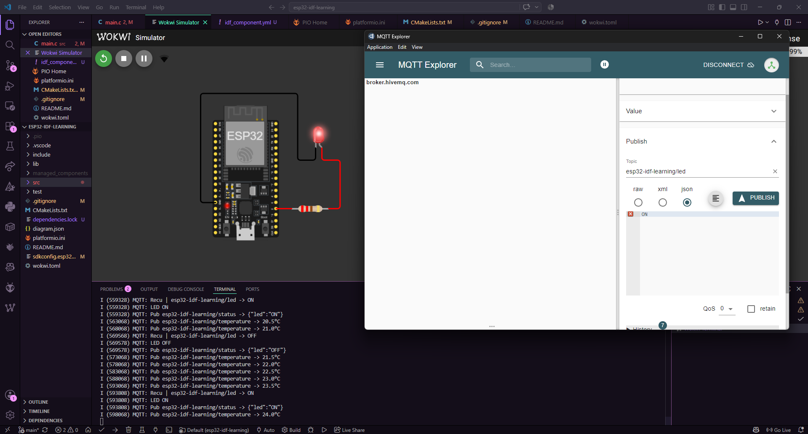

# MQTT — Publish / Subscribe avec broker HiveMQ

L'ESP32 se connecte au broker public HiveMQ et échange des messages MQTT en temps réel.
Contrôle une LED depuis MQTT Explorer et reçoit une température simulée toutes les 5 secondes.

## Topics

| Topic | Direction | Contenu |
|---|---|---|
| `esp32-idf-learning/led` | Subscribe | `ON` ou `OFF` |
| `esp32-idf-learning/status` | Publish | `{"led":"ON"}` |
| `esp32-idf-learning/temperature` | Publish | Température simulée toutes les 5s |

## Test

1. Ouvrir **MQTT Explorer** → connecter à `broker.hivemq.com:1883`
2. Lancer la simulation Wokwi
3. Publier `ON` ou `OFF` sur `esp32-idf-learning/led`
4. Observer la LED et les topics en temps réel

> MQTT requis via IDF Component Manager (`src/idf_component.yml`) — téléchargé automatiquement au premier build dans `managed_components/`.

## Concepts

`esp_mqtt_client_init` · `esp_mqtt_client_subscribe` · `esp_mqtt_client_publish` ·
`MQTT_EVENT_DATA` · publish/subscribe · broker public · QoS · `idf_component.yml`