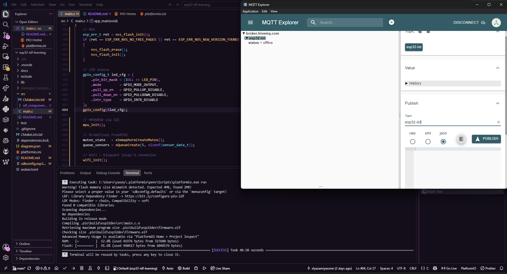
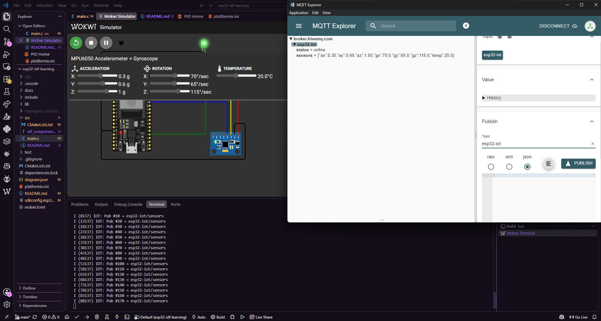

# Projet IoT Complet : MPU6050 + MQTT + Web Server + FreeRTOS

Système IoT qui combine tous les concepts appris :
le MPU6050 est lu en continu, les données partent sur MQTT et sont visibles
sur un dashboard web hébergé directement sur l'ESP32.

## Démonstration

| Système arrêté | Système en marche |
|---|---|
|  |  |

## Architecture

```
MPU6050 (I2C)
     │
task_sensor ──► Queue ──► task_mqtt_pub ──► broker.hivemq.com
     │                                            ↑
     ▼                                      MQTT Explorer
  g_data (mutex)
     │
HTTP Server ──► Dashboard navigateur
     │
task_status ──► LED verte clignote (système en vie)
```

## Ce que ça fait

- Lit le MPU6050 toutes les 500ms (accéléro X/Y/Z, gyro X/Y/Z, température)
- Publie les données sur MQTT toutes les 500ms
- Sert un dashboard web avec mise à jour automatique toutes les secondes
- LED verte clignote en permanence — preuve que le système tourne
- `esp32-iot/status` → `online` au démarrage, `offline` si déconnecté

## Topics MQTT

| Topic | Contenu |
|---|---|
| `esp32-iot/sensors` | JSON accéléro + gyro + température |
| `esp32-iot/status` | `online` / `offline` |

## Test MQTT Explorer

Connecter à `broker.hivemq.com:1883` →
les topics `esp32-iot/sensors` et `esp32-iot/status` apparaissent automatiquement.
Bouger les sliders du MPU6050 dans Wokwi → les valeurs changent en direct.

## GPIO

| GPIO | Rôle |
|---|---|
| D21 | SDA — I2C MPU6050 |
| D22 | SCL — I2C MPU6050 |
| D2 | LED verte status |

## Concepts

`i2c_master_bus` · `esp_http_server` · `esp_mqtt_client` · `xTaskCreate` ·
`xQueueSend/Receive` · `xSemaphoreTake/Give` · Last Will MQTT · dashboard HTML embarqué